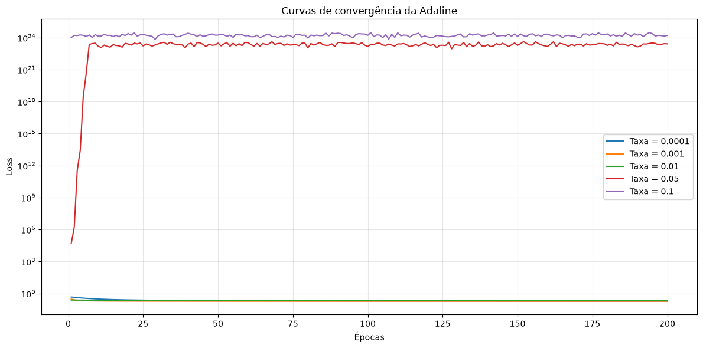
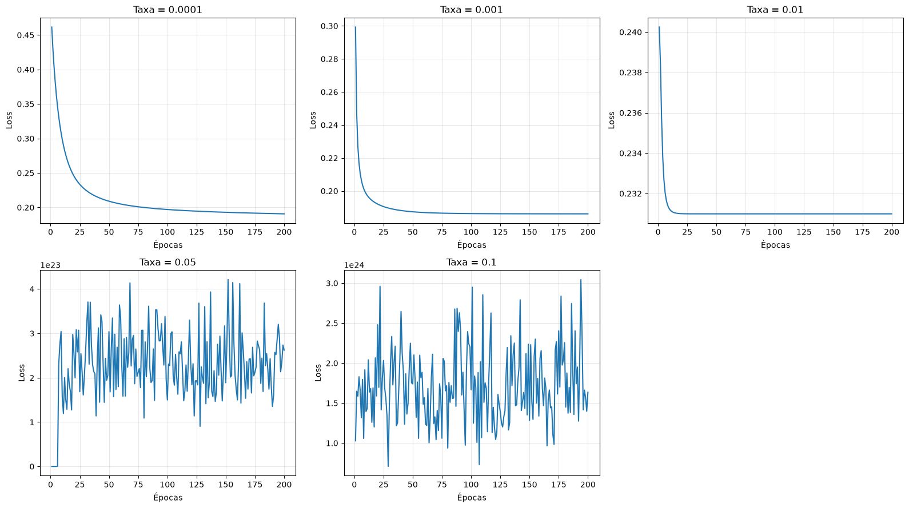
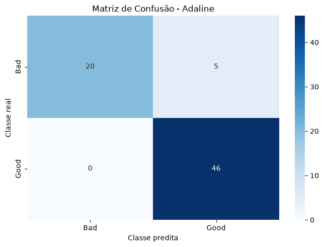

# Problema 1 — Rede Adaline para Classificação de Retornos de Radares Ionosféricos

**Disciplina:** Sistemas Inteligentes  
**Algoritmo:** Adaline (Adaptive Linear Neuron)  
**Framework:** Scikit-learn

## 1. Objetivo

O objetivo deste projeto é desenvolver uma rede Adaline para classificar retornos de radares ionosféricos, distinguindo sinais que indicam a presença de uma estrutura eletrônica coerente na ionosfera (Good) daqueles em que essa estrutura não é detectada (Bad).

## 2. Dataset e Pré-processamento

Foi utilizado o dataset *Ionosphere*, disponibilizado pela UCI Machine Learning Repository, contendo 351 amostras, 34 atributos numéricos e uma variável alvo binária.

A análise exploratória identificou a ausência de valores faltantes, dispensando a aplicação de técnicas de imputação. Também foi identificado o atributo constante `atributo_2`, removido por não apresentar variabilidade e, consequentemente, não contribuir para a distinção entre as classes. Após a remoção, permaneceram 33 atributos de entrada.

Os rótulos foram recodificados para valores bipolares, conforme a distribuição apresentada a seguir:

| Classe | Rótulo | Amostras |
|---|---:|---:|
| Good | +1 | 225 |
| Bad | -1 | 126 |
| Total | — | 351 |

Os dados foram divididos de forma estratificada em 80% para treinamento (280 amostras) e 20% para teste (71 amostras), utilizando `random_state=42`. A estratificação preservou aproximadamente a proporção original das classes em ambos os conjuntos.

Os atributos foram padronizados por Z-score com `StandardScaler`, ajustado exclusivamente aos dados de treinamento. As mesmas estatísticas foram utilizadas na transformação do conjunto de teste, evitando vazamento de informações. Após a transformação, os atributos de treinamento apresentaram média aproximadamente igual a zero e desvio-padrão igual a um.

### 2.1. Justificativa Matemática da Padronização

A padronização Z-score é representada por:

$$
z_{ij}=\frac{x_{ij}-\mu_j}{\sigma_j}
$$

Na expressão, $\mu_j$ e $\sigma_j$ representam, respectivamente, a média e o desvio-padrão do atributo $j$ calculados no conjunto de treinamento.

Considerando a saída linear da Adaline, $\hat{y}_i=\mathbf{w}^{T}\mathbf{x}_i+b$, e a perda quadrática de uma amostra:

$$
J_i=\frac{1}{2}(y_i-\hat{y}_i)^2
$$

A derivada em relação ao peso $w_j$ é:

$$
\frac{\partial J_i}{\partial w_j}=-(y_i-\hat{y}_i)x_{ij}
$$

Assim, a atualização pela regra Delta estocástica é dada por:

$$
w_j^{(t+1)}=w_j^{(t)}+\eta(y_i-\hat{y}_i)x_{ij}
$$

A magnitude da atualização depende diretamente da escala do atributo. Se um atributo for multiplicado por uma constante $c$, mantendo-se o erro fixo, a contribuição desse atributo para a atualização também será multiplicada por $c$.

Para uma amostra fixa, considerando o vetor de entrada aumentado $\tilde{\mathbf{x}}_i=(\mathbf{x}_i,1)$, que incorpora o bias, o erro após uma atualização satisfaz:

$$
e_i^{(t+1)}=(1-\eta\|\tilde{\mathbf{x}}_i\|^2)e_i^{(t)}
$$

Portanto, a redução da magnitude do erro dessa amostra exige:

$$
0<\eta<\frac{2}{\|\tilde{\mathbf{x}}_i\|^2}
$$

Atributos de grande magnitude podem reduzir o intervalo de taxas de aprendizagem que produzem atualizações estáveis. A padronização reduz diferenças de escala entre os atributos, favorecendo a estabilidade da regra Delta. Entretanto, não garante a convergência para qualquer taxa de aprendizagem, especialmente na presença de atributos correlacionados ou amostras de magnitude elevada.

## 3. Implementação e Treinamento

A rede Adaline foi implementada utilizando a classe `SGDRegressor` da biblioteca Scikit-learn, configurada com perda quadrática e descida do gradiente estocástico.

A saída linear do modelo é representada por:

$$
\hat{y}=\sum_{j=1}^{33}w_jz_j+b
$$

Durante o treinamento, a saída contínua é utilizada no cálculo do erro e na atualização dos pesos. Para a classificação, foi aplicada uma função degrau bipolar com limiar zero:

$$
f(\hat{y})=\begin{cases}
+1, & \hat{y}\geq 0 \\
-1, & \hat{y}<0
\end{cases}
$$

Os parâmetros utilizados durante o treinamento foram:

- Função de perda: erro quadrático (`squared_error`);
- Otimizador: descida do gradiente estocástico (SGD);
- Regularização: desativada (`penalty=None`);
- Taxa de aprendizagem: constante (`learning_rate="constant"`);
- Número de épocas: 200;
- Semente aleatória: 42.

O método `partial_fit()` foi utilizado para realizar uma época de treinamento por chamada, permitindo registrar a evolução da perda ao longo das 200 épocas. A perda registrada corresponde à metade do erro quadrático médio calculado no conjunto de treinamento:

$$
J=\frac{1}{2n}\sum_{i=1}^{n}(y_i-\hat{y}_i)^2
$$

### 3.1. Análise das Taxas de Aprendizagem

Foram avaliadas cinco taxas de aprendizagem, mantendo-se fixos o conjunto de treinamento, a semente aleatória e o número de épocas.

| Taxa de aprendizagem | Loss inicial (1ª época) | Loss final | Menor loss |
|---:|---:|---:|---:|
| 0,0001 | 0,461572 | 0,190674 | 0,190674 |
| 0,001 | 0,299322 | 0,186183 | 0,186183 |
| 0,01 | 0,240247 | 0,230993 | 0,230993 |
| 0,05 | 4,953087 × 10⁴ | 2,621080 × 10²³ | 4,953087 × 10⁴ |
| 0,1 | 1,028448 × 10²⁴ | 1,635109 × 10²⁴ | 7,078259 × 10²³ |

A taxa de 0,0001 apresentou redução progressiva da perda ao longo das épocas, porém com convergência mais lenta. A taxa de 0,001 apresentou redução acentuada nas primeiras épocas e posterior estabilização, atingindo a menor perda final entre as configurações avaliadas.

A taxa de 0,01 apresentou estabilização mais rápida, porém em um valor de perda superior ao obtido com 0,001. As taxas de 0,05 e 0,1 apresentaram comportamento instável, com perdas de magnitude muito elevada e oscilações durante o treinamento, indicando ausência de convergência satisfatória.

*Figura 1 – Comparação das curvas de perda das cinco taxas de aprendizagem em escala logarítmica.*

*Figura 2 – Evolução individual da perda de treinamento durante as 200 épocas para cada taxa de aprendizagem.*

Com base nos resultados, foi selecionada a taxa de aprendizagem de 0,001, que apresentou convergência estável e perda final de aproximadamente 0,186183. A seleção foi realizada exclusivamente com base na perda de treinamento, sem utilização do conjunto de teste.

## 4. Avaliação do Modelo

O modelo treinado com a taxa de aprendizagem de 0,001 foi avaliado no conjunto de teste, composto por 71 amostras. As saídas contínuas foram convertidas em rótulos bipolares utilizando o limiar zero.

A acurácia global foi de 92,96%, correspondendo a 66 classificações corretas e cinco incorretas. As métricas por classe, calculadas a partir da matriz de confusão registrada no notebook, são apresentadas a seguir:

| Métrica | Good (+1) | Bad (-1) |
|---|---:|---:|
| Precisão | 0,9020 | 1,0000 |
| Recall | 1,0000 | 0,8000 |
| F1-score | 0,9485 | 0,8889 |
| Amostras | 46 | 25 |

| Métrica global | Teste |
|---|---:|
| Acurácia | 0,9296 |

A classe Good apresentou recall de 100%, indicando que todos os 46 retornos dessa classe foram corretamente identificados. A precisão de 90,20% indica que parte das amostras classificadas como Good pertencia, na realidade, à classe Bad.

A classe Bad apresentou precisão de 100%, uma vez que todas as 20 amostras classificadas como Bad pertenciam a essa classe. Entretanto, o recall de 80% indica que cinco dos 25 retornos ruins não foram identificados pelo modelo.

### 4.1. Matriz de Confusão

| Classe real / Classe predita | Bad (-1) | Good (+1) |
|---|---:|---:|
| Bad (-1) | 20 | 5 |
| Good (+1) | 0 | 46 |

*Figura 3 – Matriz de confusão do modelo Adaline no conjunto de teste.*

A matriz de confusão demonstra que os erros de classificação ocorreram exclusivamente na identificação da classe Bad, evidenciando uma limitação do modelo na detecção de retornos sem estrutura ionosférica coerente.

### 4.2. Análise do Erro Mais Crítico

Em uma aplicação real de monitoramento ionosférico, o erro considerado mais crítico é classificar um retorno Bad como Good. Esse erro pode fazer com que uma possível falha de transmissão ou interferência deixe de ser identificada pelo sistema de monitoramento.

Considerando Good (+1) como classe positiva, esse erro corresponde a um falso positivo. Caso Bad seja considerada a classe positiva operacional, o mesmo erro corresponde a um falso negativo.

Foram observadas cinco ocorrências desse erro, representando 20% das amostras Bad no conjunto de teste. Apesar da elevada acurácia global, esse resultado demonstra a importância de analisar o recall da classe Bad, além das métricas agregadas.

## 5. Conclusão

A rede Adaline desenvolvida com Scikit-learn apresentou desempenho satisfatório na classificação de retornos de radares ionosféricos, atingindo acurácia de 92,96% no conjunto de teste.

O estudo das taxas de aprendizagem demonstrou que a escolha desse hiperparâmetro influencia diretamente a estabilidade e a qualidade da convergência. A taxa de 0,001 apresentou o melhor resultado de treinamento entre as configurações avaliadas, enquanto as taxas mais elevadas produziram atualizações instáveis.

Embora o modelo tenha identificado corretamente todos os retornos Good, cinco retornos Bad foram classificados incorretamente. Dessa forma, a Adaline constitui uma abordagem inicial adequada para o problema, porém sua utilização em sistemas operacionais exigiria atenção especial à detecção da classe Bad. Como trabalho futuro, poderiam ser investigados ajustes no limiar de decisão, utilizando um conjunto de validação independente, e modelos capazes de representar relações não lineares entre os atributos.

## 6. Referência

UCI Machine Learning Repository. *Ionosphere*. Disponível em: https://archive.ics.uci.edu/ml/datasets/Ionosphere.
